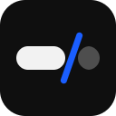
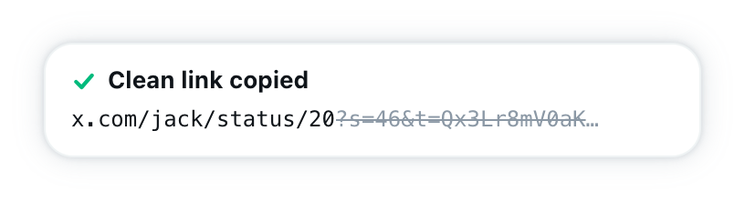
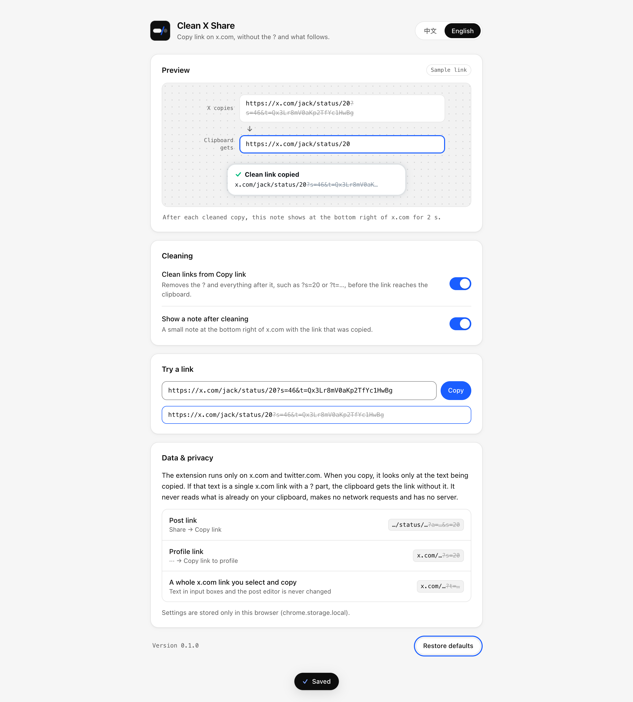

<div align="center">



# Clean X Share

**Copy link on x.com gives you the link without the `?` and everything after it.**

<p>
  
  
  
  <a href="LICENSE"></a>
</p>

<p>
  <b>English</b> ·
  <a href="README.zh-CN.md">简体中文</a>
</p>

<p>
  <a href="#quick-start">Quick start</a> ·
  <a href="#features">Features</a> ·
  <a href="#what-gets-cleaned">What gets cleaned</a> ·
  <a href="#settings">Settings</a> ·
  <a href="#how-it-works">How it works</a> ·
  <a href="#privacy">Privacy</a> ·
  <a href="#troubleshooting">Troubleshooting</a> ·
  <a href="#development">Development</a> ·
  <a href="#documentation">Documentation</a>
</p>

</div>

Clean X Share is a Chrome extension for x.com. When you click **Copy link** on a post or a profile, X appends a query string such as `?s=20` or `?a=…&s=20`. Clean X Share removes the `?` and everything after it before the link reaches your clipboard, so you paste the short link:

```diff
- https://x.com/jack/status/20?s=46&t=Qx3Lr8mV0aKp2TfYc1HwBg
+ https://x.com/jack/status/20
```

X's own Copy link still runs as usual and still shows "Copied to clipboard". The extension only changes the text that lands on the clipboard. It runs only on x.com and twitter.com, asks for no permission besides `storage`, and makes no network requests.

<div align="center">

<picture>
  <source media="(prefers-color-scheme: dark)" srcset="docs/screenshots/note-dark.png" />
  
</picture>

</div>

## Quick start

You need desktop Chrome 120 or later, and Node.js 22.18 or later with npm to build.

### 1. Build

```bash
git clone https://github.com/occcat/clean-x-share.git
cd clean-x-share
npm install
npm run build
```

The extension is now in the `dist/` folder.

### 2. Load it in Chrome

1. Open `chrome://extensions`.
2. Turn on **Developer mode** in the top right.
3. Click **Load unpacked** and select the **`dist`** folder inside the repo, not the repo folder itself.

> [!IMPORTANT]
> If Chrome says **"Manifest file is missing or unreadable"**, you selected `clean-x-share/`. Select `clean-x-share/dist/` instead. `npm run build` prints the full path to choose.

### 3. Try it

1. Open any post on x.com. Reload x.com tabs that were open before you installed the extension.
2. Click **Share → Copy link**.
3. Paste anywhere. You get the link without the `?` part, and a note at the bottom right of x.com shows what was cut.

Click the extension's toolbar icon to open its settings.

### Update

```bash
git pull
npm install
npm run build
```

Then click the reload button on the extension's card in `chrome://extensions` and reload your x.com tabs.

## Features

| Feature | What it does |
|---|---|
| **Post links** | **Share → Copy link** gives `https://x.com/user/status/123` instead of `…/status/123?a=…&s=20`. |
| **Profile links** | **··· → Copy link to profile** drops `?s=20`. |
| **Links you copy yourself** | Select a whole x.com link on the page and press <kbd>⌘</kbd> <kbd>C</kbd> or <kbd>Ctrl</kbd> <kbd>C</kbd>. It is cleaned too. |
| **Leaves your typing alone** | Copies from text boxes, the search box and the post editor are never changed. |
| **Only X links** | Other sites' links, plain text and links without a `?` are copied as they are. `x.com` and `twitter.com`, with or without `www.` or `mobile.`, count as X. |
| **A short note** | After a cleaned copy, a note at the bottom right of x.com shows the kept link and the cut part for 2 seconds. It matches X's Default, Dim and Lights out themes, and you can turn it off. |
| **Settings page** | A live preview, two switches, a **Try a link** box, English and Chinese, and **Restore defaults** with **Undo**. Changes reach open x.com tabs right away. |
| **Ready if X changes** | X copies with `document.execCommand("copy")` today. If it moves to `navigator.clipboard.writeText()`, those calls are cleaned the same way. |

## What gets cleaned

| You copy | The clipboard gets |
|---|---|
| `https://x.com/jack/status/20?s=46&t=Qx3Lr8mV0aKp2TfYc1HwBg` | `https://x.com/jack/status/20` |
| `https://x.com/jack?s=20` | `https://x.com/jack` |
| `https://twitter.com/jack/status/20?s=20` | `https://twitter.com/jack/status/20` |
| `https://x.com/jack/status/20` | Unchanged: nothing to cut |
| `https://example.com/page?id=1` | Unchanged: not an X link |
| `look at https://x.com/jack?s=20` | Unchanged: more than a link |
| An X link copied from the post editor | Unchanged: text you are editing |

The cut happens at the first `?`. A `?` that comes after `#` is part of the fragment and is kept.

## Settings

<div align="center">

<picture>
  <source media="(prefers-color-scheme: dark)" srcset="docs/screenshots/options-dark.png" />
  
</picture>

</div>

| Setting | Default | When off |
|---|---|---|
| **Clean links from Copy link** | On | Links are copied exactly as X gives them. |
| **Show a note after cleaning** | On | Links are still cleaned, without the note. |
| **Language** | Your browser's language | Pick English or 中文 for the settings page and the note. |

**Try a link** cleans any link you paste into it, and **Copy** puts the result on your clipboard. Settings are saved as soon as you change them.

## How it works

X's Copy link puts the link in a hidden `<span>`, selects it and calls `document.execCommand("copy")`. The extension listens for that `copy` event. If the selected text is a single X link with a `?` part, it replaces what goes on the clipboard with the part before the `?`. A second script wraps `navigator.clipboard.writeText()` in case X switches to the Clipboard API.

The extension never reads what is already on your clipboard. [docs/architecture.md](docs/architecture.md) explains each part.

## Privacy

- Runs only on `x.com`, `mobile.x.com`, `twitter.com` and `mobile.twitter.com`.
- Looks only at the text of the copy in progress, and keeps none of it.
- Never reads your existing clipboard, posts, messages or cookies.
- No network requests, no analytics, no server.
- Stores two switches and a language choice in `chrome.storage.local`.

See [PRIVACY.md](PRIVACY.md) for the full list of what it reads, stores and why it needs each permission.

## Troubleshooting

**"Manifest file is missing or unreadable" when loading.** You selected the repo folder. Select `dist/` inside it. If `dist/` doesn't exist yet, run `npm run build` first.

**`npm run build` fails with `ERR_UNKNOWN_FILE_EXTENSION ".ts"`.** Your Node.js is older than 22.18. The build imports TypeScript directly and needs Node 22.18 or later.

**Links still have the `?` part.**

1. Reload x.com tabs that were open before you installed or updated the extension.
2. Open the extension's settings and check that **Clean links from Copy link** is on.
3. Check that the extension is enabled in `chrome://extensions`.
4. If it still happens, X may have changed how Copy link works. [docs/architecture.md#when-x-changes](docs/architecture.md#when-x-changes) explains how to check.

**I don't want the note.** Turn off **Show a note after cleaning** in the settings. Links are still cleaned.

## Development

| Command | What it does |
|---|---|
| `npm run build` | Build into `dist/` |
| `npm run watch` | Rebuild on every change |
| `npm run typecheck` | Type-check with `tsc` |
| `npm test` | Unit tests with `node --test` |
| `npm run test:e2e` | Load `dist/` into headless Chrome for Testing and check real copies on a local stand-in for x.com |
| `npm run screenshots` | Run the e2e checks and write the README images to `docs/screenshots/` |
| `npm run icons` | Redraw `icons/*.png` |

`test:e2e` uses Playwright's Chrome for Testing from `~/Library/Caches/ms-playwright`, because branded Chrome ignores `--load-extension`. Set `CHROME=/path/to/chrome` to use another build. Headless Chrome has its own clipboard, and the run stops before any check if that clipboard turns out to be the system one.

```
src/
├── clean.ts            the rule: is this an X link, and where to cut
├── content.ts          copy listener and the note on x.com
├── bridge.ts           navigator.clipboard.writeText wrapper (page world)
├── bridge-protocol.ts  attribute and event shared by the two scripts
├── note.ts             the note's markup, styles and X theme detection
├── settings.ts         settings in chrome.storage.local
├── i18n.ts             English and Chinese strings
├── background.ts       opens settings from the toolbar icon
├── manifest.json
├── _locales/           extension name and description
└── options/            settings page
test/
├── unit/               node --test
└── e2e/run.mjs         headless Chrome for Testing
scripts/icons.py        draws icons/
build.mjs               esbuild bundle into dist/
```

Read [AGENTS.md](AGENTS.md) before you contribute. It lists the project rules, the checks to run and the commit message format.

## Documentation

| Document | Contents |
|---|---|
| [docs/architecture.md](docs/architecture.md) | How copies are caught, each module, the build, the tests, and what to check when X changes |
| [PRIVACY.md](PRIVACY.md) | What the extension reads and stores, and why it needs each permission |
| [AGENTS.md](AGENTS.md) | Project rules, checks and commit conventions for contributors and coding agents |
| [LICENSE](LICENSE) | MIT License |

## License

[MIT](LICENSE)
