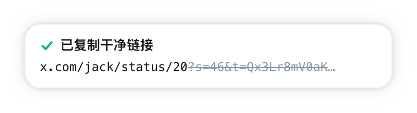
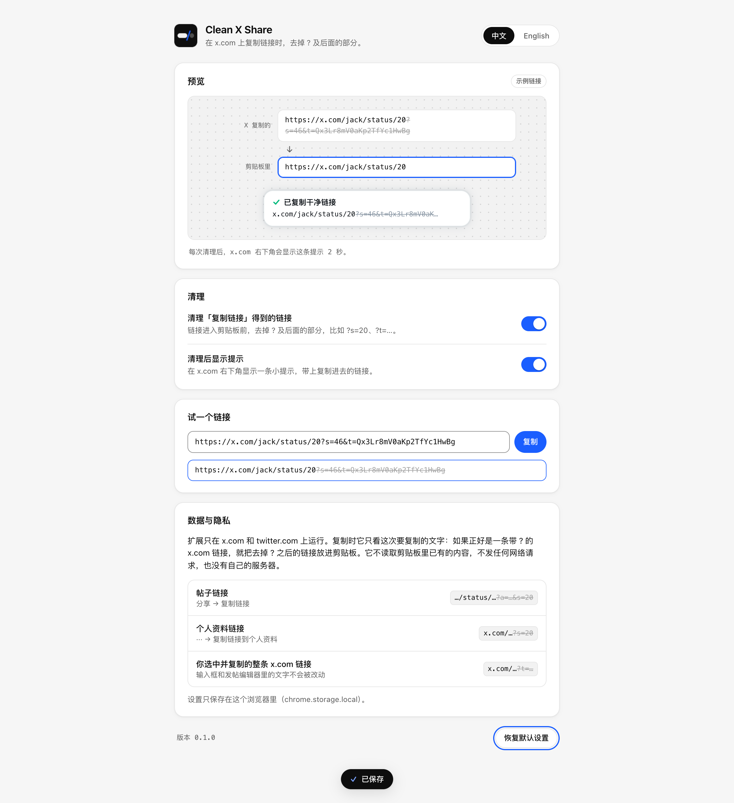

<div align="center">


# Clean X Share

**在 x.com 上点「复制链接」，剪贴板里只留下 `?` 前面的部分。**

<p>
  
  
  
  <a href="LICENSE"></a>
</p>

<p>
  <a href="README.md">English</a> ·
  <b>简体中文</b>
</p>

<p>
  <a href="#快速上手">快速上手</a> ·
  <a href="#特性">特性</a> ·
  <a href="#清理规则">清理规则</a> ·
  <a href="#设置">设置</a> ·
  <a href="#工作原理">工作原理</a> ·
  <a href="#隐私">隐私</a> ·
  <a href="#常见问题">常见问题</a> ·
  <a href="#开发">开发</a> ·
  <a href="#文档">文档</a>
</p>

</div>

Clean X Share 是一个用于 x.com 的 Chrome 扩展。在帖子或个人资料上点「复制链接」时，X 会在链接后面加上 `?s=20`、`?a=…&s=20` 这样的参数。Clean X Share 在链接进入剪贴板之前去掉 `?` 及后面的全部内容，粘贴出来就是一条短链接：

```diff
- https://x.com/jack/status/20?s=46&t=Qx3Lr8mV0aKp2TfYc1HwBg
+ https://x.com/jack/status/20
```

X 自己的「复制链接」照常运行，「已复制到剪贴板」的提示也照常出现，扩展只改动最终放进剪贴板的文字。它只在 x.com 和 twitter.com 上运行，除了 `storage` 之外不申请任何权限，也不发任何网络请求。

<div align="center">

<picture>
  <source media="(prefers-color-scheme: dark)" srcset="docs/screenshots/note-dark-zh.png" />
  
</picture>

</div>

## 快速上手

需要桌面版 Chrome 120 或更新版本。构建需要 Node.js 22.18 或更新版本和 npm。

### 1. 构建

```bash
git clone https://github.com/occcat/clean-x-share.git
cd clean-x-share
npm install
npm run build
```

构建好的扩展在 `dist/` 文件夹里。

### 2. 在 Chrome 里加载

1. 打开 `chrome://extensions`。
2. 打开右上角的「开发者模式」。
3. 点「加载已解压的扩展程序」，选择仓库里的 **`dist`** 文件夹，不要选仓库文件夹本身。

> [!IMPORTANT]
> 如果 Chrome 提示 **「清单文件缺失或不可读取」**，说明选成了 `clean-x-share/`。请改选 `clean-x-share/dist/`。`npm run build` 结束时会打印要选的完整路径。

### 3. 试一下

1. 打开 x.com 上任意一条帖子。安装扩展之前就开着的 x.com 标签页需要刷新一次。
2. 点「分享 → 复制链接」。
3. 随便粘贴到哪里。得到的是去掉 `?` 部分的链接，x.com 右下角会有一条提示，显示去掉了什么。

点工具栏上的扩展图标可以打开设置页。

### 更新

```bash
git pull
npm install
npm run build
```

然后在 `chrome://extensions` 里点扩展卡片上的刷新按钮，再刷新 x.com 标签页。

## 特性

| 特性 | 说明 |
|---|---|
| **帖子链接** | 「分享 → 复制链接」得到 `https://x.com/user/status/123`，而不是 `…/status/123?a=…&s=20`。 |
| **个人资料链接** | 「··· → 复制链接到个人资料」去掉 `?s=20`。 |
| **手动复制的链接** | 在页面上选中一整条 x.com 链接，按 <kbd>⌘</kbd> <kbd>C</kbd> 或 <kbd>Ctrl</kbd> <kbd>C</kbd>，同样会被清理。 |
| **不碰你正在输入的文字** | 从输入框、搜索框和发帖编辑器里复制的内容不会被改动。 |
| **只处理 X 链接** | 其他网站的链接、普通文字和没有 `?` 的链接都原样复制。`x.com` 和 `twitter.com`，带不带 `www.`、`mobile.` 都算 X。 |
| **简短提示** | 清理后，x.com 右下角显示 2 秒提示，列出保留的链接和去掉的部分。颜色跟随 X 的默认、暗淡和纯黑三种主题，也可以关掉。 |
| **设置页** | 实时预览、两个开关、「试一个链接」输入框、中英文切换，以及「恢复默认设置」和「撤销」。改动立即作用到已打开的 x.com 标签页。 |
| **为 X 的改版做好准备** | X 目前用 `document.execCommand("copy")` 复制。如果改用 `navigator.clipboard.writeText()`，这类调用也会按同样的规则清理。 |

## 清理规则

| 你复制的 | 剪贴板里得到的 |
|---|---|
| `https://x.com/jack/status/20?s=46&t=Qx3Lr8mV0aKp2TfYc1HwBg` | `https://x.com/jack/status/20` |
| `https://x.com/jack?s=20` | `https://x.com/jack` |
| `https://twitter.com/jack/status/20?s=20` | `https://twitter.com/jack/status/20` |
| `https://x.com/jack/status/20` | 不变：没有可去掉的部分 |
| `https://example.com/page?id=1` | 不变：不是 X 链接 |
| `look at https://x.com/jack?s=20` | 不变：不只是一条链接 |
| 从发帖编辑器里复制的 X 链接 | 不变：这是你正在编辑的文字 |

从第一个 `?` 处截断。出现在 `#` 后面的 `?` 属于片段，会保留。

## 设置

<div align="center">

<picture>
  <source media="(prefers-color-scheme: dark)" srcset="docs/screenshots/options-dark-zh.png" />
  
</picture>

</div>

| 设置 | 默认 | 关闭后 |
|---|---|---|
| **清理「复制链接」得到的链接** | 开 | 链接按 X 给的原样复制。 |
| **清理后显示提示** | 开 | 链接照样清理，只是不显示提示。 |
| **语言** | 跟随浏览器语言 | 设置页和提示可以选 English 或中文。 |

「试一个链接」会清理你粘贴进去的任何链接，点「复制」把结果放进剪贴板。所有设置在改动时立即保存。

## 工作原理

X 的「复制链接」把链接放进一个隐藏的 `<span>`，选中后调用 `document.execCommand("copy")`。扩展监听这次 `copy` 事件，如果选中的文字正好是一条带 `?` 的 X 链接，就把放进剪贴板的内容换成 `?` 前面的部分。另一个脚本包装了 `navigator.clipboard.writeText()`，以防 X 改用 Clipboard API。

扩展从不读取剪贴板里已有的内容。各部分的细节见 [docs/architecture.md](docs/architecture.md)（英文）。

## 隐私

- 只在 `x.com`、`mobile.x.com`、`twitter.com` 和 `mobile.twitter.com` 上运行。
- 只看这一次要复制的文字，看完不保留。
- 不读取剪贴板里已有的内容，也不读取你的帖子、私信或 Cookie。
- 不发网络请求，不做统计，没有服务器。
- 只在 `chrome.storage.local` 里保存两个开关和语言选择。

它读取什么、保存什么、每个权限的用途，完整说明见 [PRIVACY.md](PRIVACY.md)（英文）。

## 常见问题

**加载时提示「清单文件缺失或不可读取」。** 选成了仓库文件夹，请改选里面的 `dist/`。如果还没有 `dist/`，先运行 `npm run build`。

**`npm run build` 报 `ERR_UNKNOWN_FILE_EXTENSION ".ts"`。** Node.js 版本低于 22.18。构建脚本直接导入 TypeScript 文件，需要 Node 22.18 或更新版本。

**链接后面还带着 `?` 部分。**

1. 刷新安装或更新扩展之前就开着的 x.com 标签页。
2. 打开扩展设置，确认「清理「复制链接」得到的链接」是开着的。
3. 在 `chrome://extensions` 里确认扩展已启用。
4. 如果还是这样，可能是 X 改了「复制链接」的实现方式。排查方法见 [docs/architecture.md#when-x-changes](docs/architecture.md#when-x-changes)。

**不想看到提示。** 在设置里关掉「清理后显示提示」，链接照样会被清理。

## 开发

| 命令 | 作用 |
|---|---|
| `npm run build` | 构建到 `dist/` |
| `npm run watch` | 改动后自动重新构建 |
| `npm run typecheck` | 用 `tsc` 做类型检查 |
| `npm test` | 用 `node --test` 跑单元测试 |
| `npm run test:e2e` | 在无头 Chrome for Testing 里加载 `dist/`，在本地模拟的 x.com 上检查真实的复制结果 |
| `npm run screenshots` | 跑端到端检查，并把 README 用的图写到 `docs/screenshots/` |
| `npm run icons` | 重新生成 `icons/*.png` |

`test:e2e` 使用 `~/Library/Caches/ms-playwright` 里 Playwright 的 Chrome for Testing，因为正式版 Chrome 不支持 `--load-extension`。用 `CHROME=/path/to/chrome` 可以指定别的浏览器。无头 Chrome 有自己的剪贴板；如果发现它和系统剪贴板是同一个，测试会在任何检查之前停止。

```
src/
├── clean.ts            清理规则：是不是 X 链接、从哪里截断
├── content.ts          x.com 上的 copy 监听和提示
├── bridge.ts           页面环境里的 navigator.clipboard.writeText 包装
├── bridge-protocol.ts  两个脚本共用的属性名和事件名
├── note.ts             提示的结构、样式和 X 主题判断
├── settings.ts         chrome.storage.local 里的设置
├── i18n.ts             中英文文案
├── background.ts       点工具栏图标打开设置页
├── manifest.json
├── _locales/           扩展名称和描述
└── options/            设置页
test/
├── unit/               node --test
└── e2e/run.mjs         无头 Chrome for Testing
scripts/icons.py        生成 icons/
build.mjs               用 esbuild 打包到 dist/
```

参与开发前请先读 [AGENTS.md](AGENTS.md)（英文），里面有项目原则、提交前要跑的检查和 commit message 格式。

## 文档

| 文档 | 内容 |
|---|---|
| [docs/architecture.md](docs/architecture.md) | 如何拦截复制、各模块职责、构建、测试，以及 X 改版时要检查什么（英文） |
| [PRIVACY.md](PRIVACY.md) | 扩展读取和保存哪些数据，每个权限的用途（英文） |
| [AGENTS.md](AGENTS.md) | 面向贡献者和编码代理的项目原则、检查和提交规范（英文） |
| [LICENSE](LICENSE) | MIT 许可证 |

## License

[MIT](LICENSE)
